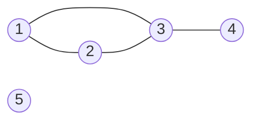
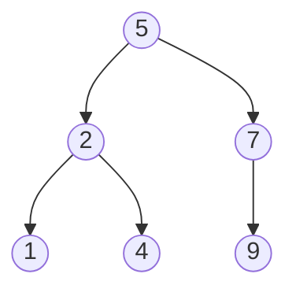

# Graph Theory 00: Introduction & Representation

Lecture notes + C++ code + homework.

|Folder / file|What it has|
|---|---|
|[`00-adjacency-matrix.cpp`](https://github.com/yahyahasan5555/DSA/blob/main/Algorithms/02-graph-theory/00-intro-and-reprsentation/00-adjacency-matrix.cpp)|adjacency matrix (count of edges)|
|[`01-adjacency-matrix-weighted.cpp`](https://github.com/yahyahasan5555/DSA/blob/main/Algorithms/02-graph-theory/00-intro-and-reprsentation/01-adjacency-matrix-weighted.cpp)|adjacency matrix with costs|
|[`02-adjacency-list.cpp`](https://github.com/yahyahasan5555/DSA/blob/main/Algorithms/02-graph-theory/00-intro-and-reprsentation/02-adjacency-list.cpp)|adjacency list|
|[`03-adjacency-list-weighted.cpp`](https://github.com/yahyahasan5555/DSA/blob/main/Algorithms/02-graph-theory/00-intro-and-reprsentation/03-adjacency-list-weighted.cpp)|adjacency list with an `edge` struct (`to`, `cost`)|
|[`homework/`](https://github.com/yahyahasan5555/DSA/blob/main/Algorithms/02-graph-theory/00-intro-and-reprsentation/homework)|the homework solutions (table at the end)|

---

## 1. Why graphs?

Many things are **objects with pairwise relations** between them:

|Example|Objects|Relations|
|---|---|---|
|Airports of a city|airports (1 to 6)|flights between them|
|Google Maps|places|roads (constraints: time / date / car)|
|Social media|people|friendships, follows|
|Computer network|computers|cables / connections|
|Human body|joints|bones|

In all of them there are **two things: objects and relationships**.

**Abstraction** = finding a general form derived from specific examples. When a problem has objects and relations, we **model it as a graph**.

---

## 2. Graph vocabulary

A **graph** `G = (V, E)` is a structure of **vertices (nodes) `V`** and **edges `E`**. An edge is a link between a pair of vertices.



|Term|Meaning|
|---|---|
|**Source / target**|for an edge from `A` to `B`: `A` is the source, `B` is the target|
|**Undirected graph**|edges have **no direction** (two-way)|
|**Directed graph**|each edge is **one-way**|
|**Weighted graph**|each edge has a value (cost, distance, time). Rarely, the vertex has it|
|**Multigraph**|the same 2 nodes have **multiple edges**|
|**Self loop**|an edge from a node to itself, e.g. `(5, 5)` (liking your own Facebook post)|
|**Neighbour**|`v` is a neighbour of `u` **iff** `(u, v)` is an edge|
|**Degree**|the number of neighbours of a node|
|**Out-degree / in-degree**|in a **directed** graph: outgoing edges / incoming edges of a node|
|**Path**|a sequence of edges that joins vertices|
|**Cycle**|a path that **starts and ends at the same node**|
|**DAG**|**D**irected **A**cyclic **G**raph: directed, with no directed cycle|
|**Connected graph**|(undirected) any two vertices are connected by a path. Otherwise it is **disconnected**|
|**Complete graph**|every pair of distinct nodes is connected|

### Complete graph

For `N` nodes:

- **undirected:** `N * (N - 1) / 2` edges
- **directed:** `N * (N - 1)` edges (each pair has 2 edges)

### Sparse vs dense

||Edges|Meaning|
|---|---|---|
|**Sparse**|`\|E\| = O(V)`|few edges, close to the number of nodes|
|**Dense**|`\|E\| = O(V²)`|many edges, close to a complete graph|

---

## 3. Trees

A **tree** is an **undirected graph where any two vertices are connected by exactly one path**. It **can't have cycles**.

How to recognize a tree with `N` nodes:

- A **connected** graph with exactly **`N - 1` edges** is a tree.
- If you **remove any edge**, it becomes **disconnected**.
- If you **add one edge**, you get **exactly one cycle**.

### Rooted tree

1. Pick one node as the **root** (the top).
2. Direct all the edges **downwards**.

Now every node has **only one parent**, except the root, which has none. (If you flip all the directions, it is also a rooted tree.)



---

## 4. Adjacency matrix

Represent a graph of `V` nodes with a `V x V` matrix. Index the vertices `0, 1, ..., V-1`.

```
mat[i][j] = how many edges between node i and node j
```

- **Undirected:** `mat[i][j] == mat[j][i]` (the matrix is symmetric).
- **Directed:** only `mat[from][to]` changes.
- **Tip:** if you only care whether an edge **exists** or not, it's a **binary matrix** (0 / 1).

Example (undirected, 4 nodes, edges `0-1`, `0-2`, `1-2`, `2-3`):

```
     0  1  2  3
  0  0  1  1  0
  1  1  0  1  0
  2  1  1  0  1
  3  0  0  1  0
```

Code: [`00-adjacency-matrix.cpp`](https://github.com/yahyahasan5555/DSA/blob/main/Algorithms/02-graph-theory/00-intro-and-reprsentation/00-adjacency-matrix.cpp)

```cpp
using Graph = vector<vector<int>>;

void add_undirected_edge(Graph& mat, int from, int to) {
    mat[from][to] += 1;
    mat[to][from] += 1;
}

void add_directed_edge(Graph& mat, int from, int to) {
    mat[from][to] += 1;
}

Graph graph(nodes, vector<int>(nodes));   // V x V zeros
```

Input: `nodes edges`, then `edges` lines of `from to` (0-based). The sample in the file has repeated edges, so the output shows counts like `There are 3 edges`.

### Weighted graph (matrix)

Use the **cost** instead of the number of edges: `mat[i][j] = cost`.

Code: [`01-adjacency-matrix-weighted.cpp`](https://github.com/yahyahasan5555/DSA/blob/main/Algorithms/02-graph-theory/00-intro-and-reprsentation/01-adjacency-matrix-weighted.cpp)

```cpp
void add_undirected_edge(Graph& mat, int from, int to, int cost) {
    mat[from][to] = cost;
    mat[to][from] = cost;
}
```

### Missing edges and multiple edges

The problem itself decides how to handle them:

|Case|Options|
|---|---|
|**Missing edge**|`0`: fine **only if every weight > 0** (then `mat[i][j] == 0` means "no edge")|
||**infinity** (a big value like `1e9`): common in the **shortest path** problem (cheapest flight from Cairo to New York), because the algorithms can simply ignore such edges|
||a separate **boolean matrix** that says if the edge exists|
|**Multiple edges**|for the shortest path, **keep the minimum** cost among them|

### Complexity (matrix)

|Question|Time|
|---|---|
|**Space**|**O(V²)**|
|Is there an edge `(u, v)`?|**O(1)**: `mat[u][v]`|
|List all the neighbours of `u`|**O(V)**: scan the row|
|Traverse the whole graph|**O(V²)**: scan the matrix|

- **Good for dense graphs.** For a sparse graph it's mostly zeros (wasted memory).
- **Non-zero values on the diagonal** mean there are **self loops** (`mat[i][i] += 1`).

---

## 5. Adjacency list

The matrix doesn't work well with **sparse** graphs. The **adjacency list** saves memory:

> For each node, keep a **list of its neighbours**.

We don't create a 2D matrix. We create a **vector of nodes, each with an (initially empty) vector**.

Code: [`02-adjacency-list.cpp`](https://github.com/yahyahasan5555/DSA/blob/main/Algorithms/02-graph-theory/00-intro-and-reprsentation/02-adjacency-list.cpp)

```cpp
using Graph = vector<vector<int>>;

void add_undirected_edge(Graph& mat, int from, int to) {
    mat[from].push_back(to);
    mat[to].push_back(from);
}

void add_directed_edge(Graph& mat, int from, int to) {
    mat[from].push_back(to);
}

Graph graph(nodes);   // inner vectors are empty!
```

Output for the sample:

```
Node: 0 has neighbors: 1 1
Node: 1 has neighbors: 0 2 0
Node: 2 has neighbors: 1 3 3
Node: 3 has neighbors: 2 4 2 4 4
Node: 4 has neighbors: 3 3 3
```

### Weighted graph (list)

Replace the `int` (the `to` node) with the **edge information**: `to` and `cost`. We can use `pair<int, int>` or a simple struct:

Code: [`03-adjacency-list-weighted.cpp`](https://github.com/yahyahasan5555/DSA/blob/main/Algorithms/02-graph-theory/00-intro-and-reprsentation/03-adjacency-list-weighted.cpp)

```cpp
struct edge {
    int to;
    int cost;
};

using Graph = vector<vector<edge>>;

void add_undirected_edge(Graph& mat, int from, int to, int cost) {
    mat[from].push_back({to, cost});
    mat[to].push_back({from, cost});
}
```

### Concerns

|Question|Answer|
|---|---|
|**Self loops?**|easy to detect and cancel or keep|
|**Keep only one edge from multiple edges?**|you must **iterate on the node's neighbours** to check if the edge exists|
|**Remove an edge?**|iterate to find it, then remove it. **Or swap it with the last edge** and remove the last one (O(1) after finding it)|
|**Iterate on edges ordered by `to` or by `cost`?**|after building the graph, **sort each node's neighbours**|

> Note: in `add_undirected_edge`, a self loop `(u, u)` is added **twice** to `u`'s list (and counted **twice** in the matrix). Decide how your problem wants to count it.

### Complexity (list)

|Question|Time|
|---|---|
|**Space**|**O(E + V)**|
|Is there an edge `(u, v)`?|**O(degree(u))**: scan the neighbours of `u`|
|List all the neighbours of `u`|**O(degree(u))**|
|Traverse the whole graph|**O(E + V)** (we use both for graphs)|
|In-degree of a node (directed)|**O(E + V)**: scan all the lists|

- **Flexible, biased toward sparse graphs.**
- For a **dense** graph it uses **more memory than the matrix**, because of the list overhead.

### Matrix vs list

||Matrix|List|
|---|---|---|
|Space|`O(V²)`|`O(E + V)`|
|Edge `(u, v)` exists?|`O(1)`|`O(degree(u))`|
|Neighbours of `u`|`O(V)`|`O(degree(u))`|
|Traverse everything|`O(V²)`|`O(E + V)`|
|Best for|**dense** graphs|**sparse** graphs (most problems)|

> Graph representation is much more generic than these two. **Don't trap yourself** in these ideas.

---

## 6. Rooted tree representation

- A tree has only `N - 1` edges, so an adjacency list works well.
- But there is an interesting representation for **rooted** trees: **every node has only ONE parent**, so a single array is enough:

```cpp
vector<int> parent(n);
parent[i] = j;   // (j, i) is an edge: j is the parent of i
```

- **Space: O(V)**.
- Finding the **parent** of a node: **O(1)**.
- Finding the **children** (neighbours) of a node: **O(V)** (scan the array).

---

## 7. Homework

Problems from the course doctor (not from an online judge). All solutions are in [`homework/`](https://github.com/yahyahasan5555/DSA/blob/main/Algorithms/02-graph-theory/00-intro-and-reprsentation/homework).

|#|Problem|Solution|
|---|---|---|
|1|Edge list|[00-edge-list.cpp](https://github.com/yahyahasan5555/DSA/blob/main/Algorithms/02-graph-theory/00-intro-and-reprsentation/homework/00-edge-list.cpp)|
|2|HashSet representation|[01-hashset-repr.cpp](https://github.com/yahyahasan5555/DSA/blob/main/Algorithms/02-graph-theory/00-intro-and-reprsentation/homework/01-hashset-repr.cpp)|
|3|Adjacency matrix with multiple edges|[02-adj-matrix-multiple-edges.cpp](https://github.com/yahyahasan5555/DSA/blob/main/Algorithms/02-graph-theory/00-intro-and-reprsentation/homework/02-adj-matrix-multiple-edges.cpp)|
|4|Airports (v1)|[03-airports-v1.cpp](https://github.com/yahyahasan5555/DSA/blob/main/Algorithms/02-graph-theory/00-intro-and-reprsentation/homework/03-airports-v1.cpp)|
|5|Airports (v2)|[04-airports-v2.cpp](https://github.com/yahyahasan5555/DSA/blob/main/Algorithms/02-graph-theory/00-intro-and-reprsentation/homework/04-airports-v2.cpp)|
|6|Image as a graph|[05-image-as-graph.cpp](https://github.com/yahyahasan5555/DSA/blob/main/Algorithms/02-graph-theory/00-intro-and-reprsentation/homework/05-image-as-graph.cpp)|
|7|Print chain|[06-print-chain.cpp](https://github.com/yahyahasan5555/DSA/blob/main/Algorithms/02-graph-theory/00-intro-and-reprsentation/homework/06-print-chain.cpp)|
|8|Print length-2 paths|[07-print-length2-paths.cpp](https://github.com/yahyahasan5555/DSA/blob/main/Algorithms/02-graph-theory/00-intro-and-reprsentation/homework/07-print-length2-paths.cpp)|
|9|Find universal sink|[slow v1](https://github.com/yahyahasan5555/DSA/blob/main/Algorithms/02-graph-theory/00-intro-and-reprsentation/homework/08-find-universal-sink-slow-imp-v1.cpp), [slow v2](https://github.com/yahyahasan5555/DSA/blob/main/Algorithms/02-graph-theory/00-intro-and-reprsentation/homework/08-find-universal-sink-slow-imp-v2.cpp), [fast v3](https://github.com/yahyahasan5555/DSA/blob/main/Algorithms/02-graph-theory/00-intro-and-reprsentation/homework/08-find-universal-sink-fast-imp-v3.cpp)|

---