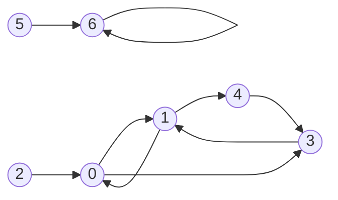
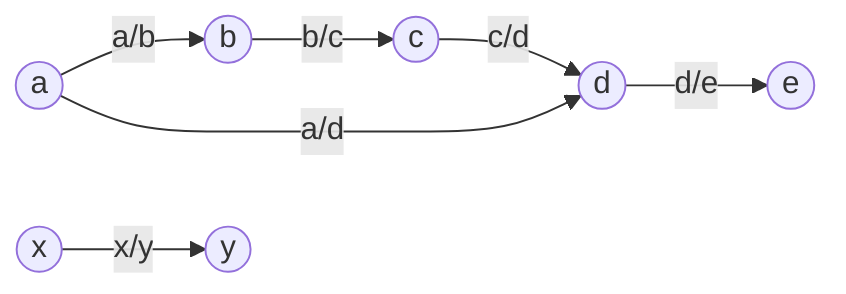
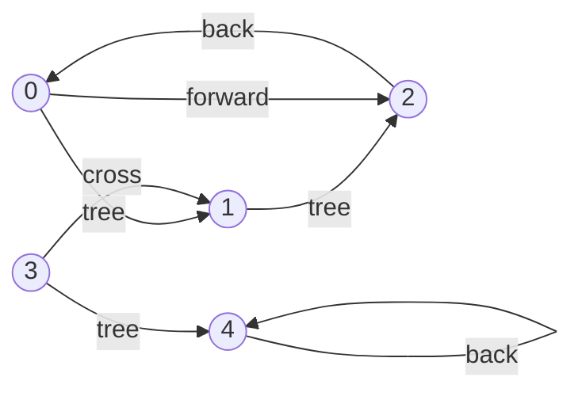

# Graph Theory 01: DFS (Depth-First Search)

## 1. What is DFS?

DFS is a **recursive algorithm for traversing a graph**. It starts from a given node and goes **as deep as possible** before coming back.

```
DFS(node):
    mark node as visited
    for each neighbour of node:
        if neighbour is not visited:
            DFS(neighbour)
```

- The **visited** array is what stops us from going around a cycle forever.
- We can also write an **iterative** version using a **stack** (the recursion itself uses the call stack).
- **Time:** `O(V + E)` with an adjacency list (every node once, every edge once). With an adjacency matrix it is `O(V²)`.

---

## 2. The reachability problem

> Given an **unweighted directed** graph. For **every node `S`**, list all the nodes that are **reachable** from `S`. Node `T` is reachable from `S` if there is **some path** from `S` to `T`.

Idea: run a DFS from every node `S`, with a **fresh visited array** each time. Everything the DFS visits is reachable from `S`.

Code: [`00-reachability-problem.cpp`](https://github.com/yahyahasan5555/DSA/blob/main/Algorithms/02-graph-theory/01-dfs/00-reachability-problem.cpp)

```cpp
void dfs(int node, const Graph& graph, vector<bool>& visited) {
    visited[node] = true;

    for(int neighbor: graph[node]) {
        if(!visited[neighbor]) {
            cout << "We can reach: " << neighbor << '\n';
            dfs(neighbor, graph, visited);
        }
    }
}

void print_reachability(const Graph& graph) {
    int sz {(int) graph.size()};

    for(int node {}; node < sz; ++node) {
        cout << "Reachable set of node " << node << " is:\n";
        vector<bool> vis(sz); // Reset
        dfs(node, graph, vis);
    }
}
```

Sample graph (7 nodes, 9 edges):



|Node|Reachable set|
|---|---|
|0|1, 4, 3|
|1|4, 3, 0|
|2|0, 1, 4, 3|
|3|1, 4, 0|
|4|3, 1, 0|
|5|6|
|6|(nothing)|

> The start node itself is **not printed** (it is marked visited first), even if it is on a cycle. Node 6 has a self loop, but it is already visited.

### Complexity

||Complexity|Why|
|---|---|---|
|**One** `dfs()` call|time **O(V + E)**|each node once, each edge once|
|**All** nodes (`print_reachability`)|time **O(V · (V + E))**|V DFS calls|
|**Memory** (auxiliary)|**O(V)**|visited array `V` + recursion stack at most `V` calls|
|Graph itself|O(V + E)|it is the input, not counted as auxiliary|

**About the memory:** the visited array is `O(V)` and the recursion stack is `O(V)` (the deepest chain has at most `V` calls, and each call has only `O(1)` local variables). `O(V) + O(V) = O(V)`. It is **not** `O(V²)`. The `V²` only appears in the **time** (the reset of `visited` for each start node, plus the V DFS calls), not in the memory, because the visited array is freed and recreated each time, so only one exists at a time.

> **In practice:** deep recursion can crash. A chain of **100,000** nodes worked for me, but a chain of **1,000,000** nodes gave a segmentation fault with the default 8 MB stack. For huge graphs use the iterative stack version.

---

## 3. Iterative Deepening DFS (IDDFS)

Sometimes going **very deep** is not good: the solution may be at depth 8 (edges) while the DFS wanders down a path of depth 1000.

**IDDFS** is a simple variant:

1. Modify DFS to have a **depth limit `D`**.
2. Whenever the DFS makes nested calls deeper than `D`, **return** from them.
3. Run the DFS from `main` with several limits:

```cpp
for(int depth = 0; depth <= MAX; ++depth)
    if(dfs(graph, depth))     // found the answer within this depth limit
        break;
```

Code: [`01-iddfs.cpp`](https://github.com/yahyahasan5555/DSA/blob/main/Algorithms/02-graph-theory/01-dfs/01-iddfs.cpp) (finds the **minimum number of edges** from a source to a target)

||BFS|DFS|IDDFS|
|---|---|---|---|
|Finds the shortest path (in edges)|yes|no|**yes**|
|Memory|large (a whole level)|small (the depth)|**small (the depth)**|

- The first limit that works is the shortest path, because we try the limits in increasing order.
- The upper levels are repeated for every limit, but the **last level is the biggest**, so the repeated work is small.
- **You will rarely use it.** Just be familiar with the name.

---

## 4. DFS on a matrix (implicit graphs)

Sometimes we are given a graph of `N` nodes and `E` edges **without building it**. The graph is **implicit**:

|Case|Example|
|---|---|
|**1. Very systematic graph**|a **2D grid** (an image). Each cell `(i, j)` has 4 or 8 neighbours around it. Building the graph only wastes time and memory, so we loop on the cells and **generate the neighbours on the fly**.|
|**2. A huge graph (millions or billions of nodes)**|**coding games**: each **state** is a node. Because of the memory limits we can't build it. We still know how to generate the neighbours of a given state, so we traverse it **implicitly**.|

### Flood fill

An algorithm that **finds a connected region and changes it**.

- Very useful in Photoshop-like applications: the connection is based on **colour similarity**.
- Imagine clicking on a red cow to change it to yellow in a single click.

### Building the graph: explicit vs implicit

||Explicit|Implicit|
|---|---|---|
|Idea|create `R × C` nodes and link them|generate the neighbours **when you need them**|
|Node index|`index(r, c) = r * C + c` (flatten the array)|not needed|
|Get `(r, c)` back|`r = index / C`, `c = index % C`||
|Example edge|`edge(index(r, c), index(r, c + 1))` (the right neighbour)||
|Cost|time and memory to build|**nothing**|

**Overall:**

- Theoretically there is **no difference** from DFS itself. We just met a case where the graph is different.
- **Implicit is effective if generating an edge is `O(1)`.**
- If generating the edges is slow, an explicit graph may be better. But the graph usually has millions of nodes and edges!

### The direction arrays

Code: [`02-flood-fill.cpp`](https://github.com/yahyahasan5555/PS/blob/main/online-judges/leetcode/leetcode-733.cpp)

```
Input grid, click (row 1, col 0), new colour 5:

1 1 0 2          5 5 0 2
1 0 0 2    ->    5 0 0 2
1 1 2 2          5 5 2 2
```

> If `old_color == new_color`, **don't** start the fill. The cells would never look "changed", so the recursion would never stop.

---

## 5. Reduction

Sometimes you read a problem and there is **ZERO connection with graph theory**. With smart observations, we can **model it as a graph**!

**Example:** given a set of fractions as pairs of symbols: `a/b`, `x/y`, `a/d`. Can you see a connection with graphs?

- Every fraction `a/b` is an **edge** between 2 nodes.
- Fractions like `a/b, b/c, c/d, d/e` build a **path**: `[a, b, c, d, e]`.
- Edge weight? The actual fraction value, e.g. `a/b`.



**No rules:** when it comes to creativity, the rules are limited. You will need to realize **what the objects (nodes) and the relations (edges) might be**.

---

## 6. DFS for cycle detection in directed graphs

**So far:** we learned DFS cycle detection in **undirected** graphs. A visited neighbour (other than the parent we came from) means a cycle.

**In directed graphs a visited array is NOT enough.** A node can be visited without being on a cycle:

```
0 -> 1 -> 2        and also   0 -> 2
```

Node `2` is visited twice, but there is **no cycle**. We need to know **how** the visited node is related to the current node.

### Directed edge classification

|Type|Edge `(u, v)`|Meaning|
|---|---|---|
|**Tree edge**|`v` is **not visited** yet|the edge that builds the DFS tree|
|**Forward edge**|`v` is visited, and `u` is an **ancestor** of `v`|a shortcut to a descendant (same DFS tree)|
|**Back edge**|`v` is visited, and `v` is an **ancestor of `u`** (or `u` itself)|**creates a cycle**: `v -> ... -> u -> v`|
|**Cross edge**|`v` is visited, and `u` is **neither an ancestor nor a descendant** of `v`|`v` is in another branch, or in an earlier DFS tree|

> Only **back edges** create cycles. **A directed graph has a cycle if and only if DFS finds a back edge.**



### How can we determine the edge class? By timing the nodes

Create two arrays, `started` and `finished`, initialized to `-1`:

```
DFS(node, time):
    started[node] = time;  time++
    DFS calls for node's neighbours
    finished[node] = time;  time++
```

- `started[x] == -1`: not visited yet.
- `finished[x] == -1` (but started): the call of `x` is **still running**, so `x` is **on the recursion stack** (an ancestor of the current node).

Code: [`03-edge-classification.cpp`](https://github.com/yahyahasan5555/DSA/blob/main/Algorithms/02-graph-theory/01-dfs/02-edge-classification.cpp)

```cpp
void dfs(GRAPH &graph, int node, vector<int> &started, vector<int> &finished, int &time) {
    started[node] = time++;

    for (int neighbour : graph[node]) {
        if (started[neighbour] == -1) {                        // tree edge
            cout << "Tree Edge: " << node << " " << neighbour << "\n";
            dfs(graph, neighbour, started, finished, time);
        } else {                                                // 3 cases for a visited node
            if (started[node] < started[neighbour])
                cout << "Forward Edge: " << node << " " << neighbour << "\n";
            else if (finished[neighbour] == -1)
                cout << "Back Edge (cycle): " << node << " " << neighbour << "\n";
            else
                cout << "Cross Edge: " << node << " " << neighbour << "\n";
        }
    }
    finished[node] = time++;
}
```

### Explaining the conditions

|Check (in this order)|Why it means this|
|---|---|
|`started[neighbour] == -1`|never visited, so we go into it: **tree edge**|
|`started[node] < started[neighbour]`|the neighbour is visited but **started after us**. It could only be discovered inside our own call, so it is our **descendant**: **forward edge**|
|`finished[neighbour] == -1`|the neighbour started **before** us and is **still running**, so it is on the stack, an **ancestor** (or the node itself, for a self loop): **back edge**|
|otherwise|the neighbour started before us and **already finished**: it is neither an ancestor nor a descendant: **cross edge**|

**Is there an easier way** to only detect a cycle? Yes: keep a boolean `on_stack[node]` (true when the call starts, false when it ends). If the neighbour is visited **and** `on_stack`, it is a back edge. It is the same as `finished[neighbour] == -1`.

Output for the example graph above:

```
Tree Edge: 0 1
Tree Edge: 1 2
Back Edge (cycle): 2 0
Forward Edge: 0 2
Cross Edge: 3 1
Tree Edge: 3 4
Back Edge (cycle): 4 4
```

**Notes**

- The class of an edge depends on the **order** in which DFS visits the nodes (the order of the adjacency lists, and the start nodes). The same graph can give different classes, but a cycle is always found.
- In **undirected** graphs there are **no forward or cross edges** (every edge is a tree edge or a back edge). That is why cycle detection was easy there. 
- Comparing `started` and `finished` times can classify all 3 cases directly.

---

## 7. Homework

### DFS basics

| #   | Problem                                                                                                                                                       | Idea                                                             | Solution                                                                                                   |
| --- | ------------------------------------------------------------------------------------------------------------------------------------------------------------- | ---------------------------------------------------------------- | ---------------------------------------------------------------------------------------------------------- |
| 1   | [LeetCode 582 - Kill Process](https://leetcode.com/problems/kill-process/)                                                                                    | build the tree (parent -> children), DFS from the killed process | [leetcode-582.cpp](https://github.com/yahyahasan5555/PS/blob/main/online-judges/leetcode/leetcode-582.cpp) |
| 2   | [LeetCode 690 - Employee Importance](https://leetcode.com/problems/employee-importance/)                                                                      | DFS over the subordinates and sum the importance                 | [LeetCode_690.cpp](https://github.com/yahyahasan5555/PS/blob/main/online-judges/leetcode/LeetCode_690.cpp) |
| 3   | [LeetCode 323 - Number of Connected Components in an Undirected Graph](https://leetcode.com/problems/number-of-connected-components-in-an-undirected-graph/)  | count how many times a new DFS starts                            | [leetcode-323.cpp](https://github.com/yahyahasan5555/PS/blob/main/online-judges/leetcode/leetcode-323.cpp) |

### DFS on a matrix

|#|Problem|Idea|Solution|
|---|---|---|---|
|4|[LeetCode 733 - Flood Fill](https://leetcode.com/problems/flood-fill/)|the flood fill from this README|[leetcode-733.cpp](https://github.com/yahyahasan5555/PS/blob/main/online-judges/leetcode/leetcode-733.cpp)|
|5|[LeetCode 1905 - Count Sub Islands](https://leetcode.com/problems/count-sub-islands/)|DFS on an island of `grid2`, check that every cell is land in `grid1`|[leetcode-1905.cpp](https://github.com/yahyahasan5555/PS/blob/main/online-judges/leetcode/leetcode-1905.cpp)|
|6|[LeetCode 1254 - Number of Closed Islands](https://leetcode.com/problems/number-of-closed-islands/)|an island is closed if its DFS never reaches the border|[leetcode-1254.cpp](https://github.com/yahyahasan5555/PS/blob/main/online-judges/leetcode/leetcode-1254.cpp)|

### Reduction

|#|Problem|Idea|Solution|
|---|---|---|---|
|7|[LeetCode 128 - Longest Consecutive Sequence](https://leetcode.com/problems/longest-consecutive-sequence/)|numbers are nodes, `x -> x + 1` are edges|[leetcode-128.cpp](https://github.com/yahyahasan5555/PS/blob/main/online-judges/leetcode/leetcode-128.cpp)|
|8|[LeetCode 1743 - Restore the Array From Adjacent Pairs](https://leetcode.com/problems/restore-the-array-from-adjacent-pairs/)|each pair is an edge, the array is a path that starts at a node of degree 1|[LeetCode1743.cpp](https://github.com/yahyahasan5555/PS/blob/main/online-judges/leetcode/LeetCode1743.cpp)|
|9|[LeetCode 1202 - Smallest String With Swaps](https://leetcode.com/problems/smallest-string-with-swaps/)|each swap pair is an edge, then sort inside every connected component|[leetcode-1202.cpp](https://github.com/yahyahasan5555/PS/blob/main/online-judges/leetcode/leetcode-1202.cpp)|
|10|[LeetCode 785 - Is Graph Bipartite?](https://leetcode.com/problems/is-graph-bipartite/)|colour the nodes with 2 colours while doing DFS|[leetcode-785.cpp](https://github.com/yahyahasan5555/PS/blob/main/online-judges/leetcode/leetcode-785.cpp)|

---

## Summary

- **DFS** goes deep first, marks nodes as **visited**, and takes **O(V + E)** time with an adjacency list. Memory: **O(V)** (visited + recursion stack).
- **Reachability:** a DFS from every node with a fresh visited array: **O(V · (V + E))** time.
- **IDDFS:** DFS with a growing depth limit. It finds the shortest path with a small memory.
- **Grids** are **implicit graphs**: generate the neighbours on the fly with `dr[]` / `dc[]`. **Flood fill** = DFS on a grid.
- **Reduction:** model a problem that looks unrelated as a graph (fractions are edges).
- **Directed graphs:** a visited array is not enough. Use `started` / `finished` times to classify edges as **tree, forward, back, cross**. **A back edge means a cycle.**